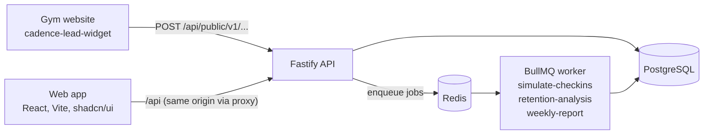

# Cadence CRM

[](https://github.com/sergiomeyer23/cadence-crm/actions/workflows/ci.yml)


[](LICENSE)

*Keep every member in rhythm. Zero silent churn.*

[English](#english) · [Português](#português)

## English

Cadence CRM is a retention radar for gyms, boutique studios and personal trainers. It reads check-ins, compares them with each student's weekly goal and sorts everyone into four columns: on track, starting to miss workouts, needs a call today, and paused because of an injury. Coaches log calls and follow-ups on the student's own timeline, and a small widget lets the gym's website send trial sign-ups straight into the board.

### The problem

Members rarely cancel out of nowhere. Attendance drops first: three workouts a week become one, then none, and by the time the cancellation arrives nobody has talked to that person in weeks. A generic CRM is organized around leads and sales pipelines, and attendance data never reaches it. Cadence CRM watches attendance against the goal agreed with each student and puts the people who need a conversation at the top of the coach's screen, while there is still time to bring them back.

### Features

- Radar board with four columns (`ACTIVE`, `WARNING`, `AT_RISK`, `PAUSED_INJURY`), a "my students / whole gym" filter and polling every 3 seconds
- Student drawer with metrics, status reason, contact log, follow-ups and a full timeline
- Injury pause: the student leaves the evaluation and starts fresh when they come back
- Website widget (`<cadence-lead-widget>`) that creates a new student from any site, with the `utm_source` recorded
- Weekly report per workspace: workouts, contacts, who recovered, who became at risk, and who is at risk without a contact
- Week simulation for demos: advances the gym's clock by 7 days and generates that week's workouts

### Architecture



| Path | Contents |
| --- | --- |
| `apps/api` | Fastify: session auth, students, contacts, Radar, public leads endpoint, Bull Board |
| `apps/worker` | BullMQ jobs: `simulate-checkins`, `retention-analysis` (every 60 s), `weekly-report` (Mondays 8:00) |
| `apps/web` | React, Vite, Tailwind and shadcn/ui; the embeddable widget lives in `public/embed` |
| `packages/shared` | Zod schemas, API types and the frequency rule |
| `packages/db` | Drizzle schema, migrations, seed and the retention analysis service |

### Engineering highlights

- The frequency rule is a pure function with configurable constants (`packages/shared/src/frequency-rule.ts`) and its own unit tests for the floor, the ceiling, new students and injury pauses.
- Each workspace has its own clock (`clock_offset_days`). The simulation advances it with a compare-and-set on the current offset, so a retried job or a double click never simulates the same week twice. Workouts are drawn with mulberry32 seeded by workspace and week, so the same week always produces the same check-ins.
- `retention-analysis` is idempotent. It writes `STATUS_CHANGED` only when the status changes, and the update is conditioned on the status it read, which keeps concurrent runs from duplicating events. Tests cover sequential and concurrent runs.
- Workspace isolation: every query filters by the `workspace_id` of the logged-in user, and IDs from another workspace return 404. This is enforced in application code; PostgreSQL row-level security is not enabled yet.
- The public endpoint has a per-IP rate limit stored in Redis (so it holds across instances), a 10 KB body limit, Zod validation and a honeypot field. CORS is open only under `/api/public/`; every other route accepts the configured origins with credentials.
- `GET /api/health` checks PostgreSQL and Redis and returns 503 when either is down.

### Frequency rule

Two signals are evaluated and the worse one wins.

1. Adherence: workouts in the last 14 days divided by the expected count (weekly goal × 14 ÷ 7). Below 60% the student goes to `WARNING`; below 30%, to `AT_RISK`.
2. Absence: days since the last workout compared with a tolerance of twice the expected interval between workouts (7 ÷ goal), with a floor of 4 days and a ceiling of 10. Past the tolerance means `WARNING`; past twice the tolerance means `AT_RISK`. With a goal of 3 workouts a week, the tolerance is 4.7 days and risk starts at 9.3 days.

Paused students stay in `PAUSED_INJURY` and are not evaluated. During the first 7 days after enrollment only absence counts, and until day 14 the adherence window is the number of days since enrollment. Resuming after a pause restarts tracking from the resume date. Every constant can be overridden with `FREQUENCY_RULE_OVERRIDES` (JSON), read by both the API and the worker.

### Local setup

You need Node 22+, pnpm 10 and Docker.

```bash
cp .env.example .env
```

```bash
pnpm install
```

```bash
pnpm bootstrap
```

```bash
pnpm dev
```

`pnpm bootstrap` starts PostgreSQL and Redis with Docker Compose, runs the migrations and loads the demo data. `pnpm dev` runs the API, the worker and the web app together.

- Web: http://localhost:5173
- API: http://localhost:3333 (the web app reaches it through the Vite proxy at `/api`)
- Bull Board: http://localhost:5173/admin/queues, with `BULL_BOARD_USER` and `BULL_BOARD_PASSWORD`
- Widget demo page: http://localhost:5173/embed/demo.html?workspace=ID (the "Widget do site" button shows the ID)

Demo accounts, all with the password `demo1234`:

| Email | Role |
| --- | --- |
| helena@ritmo.test | Owner of Academia Ritmo (40 students) |
| rafael@ritmo.test | Coach at Academia Ritmo |
| patricia@ritmo.test | Coach at Academia Ritmo |
| marcos@personal.test | Independent personal trainer (8 students) |

Running `pnpm db:seed` again wipes everything and recreates this data, including the simulated clock.

```bash
pnpm test
```

```bash
pnpm build
```

The API and worker tests use the `cadence_test` database, created by `docker/postgres/init.sql` the first time the Postgres volume starts. `pnpm build` runs the typecheck, bundles the API and worker with esbuild and builds the web app.

### Live demo

1. Log in as Helena. Gustavo Pereira sits in the at-risk column; open him, check the metrics and the timeline, and log a WhatsApp contact with a follow-up date.
2. Click "Simular semana de treinos". The worker advances the clock by a week, generates the workouts and runs the analysis. A few seconds later some cards change columns and are highlighted with "Veio de ...", the header date moves forward and the weekly report appears at the top.
3. Students with a recent contact tend to come back. The ones drifting away (Larissa Carvalho, Vinícius Teixeira, André Vieira, Otávio Siqueira) slide to Atenção and then Em risco.
4. Pause someone for an injury and watch the card move at once. Switch between "Meus alunos" and "Toda a academia", and log in as Rafael (coach) or Marcos (personal trainer) to see their views.
5. Open "Widget do site", follow the example page link and submit the form. The new student shows up in Ativos with "Cadastro pelo site" on the timeline.
6. Open `/admin/queues` to see the three queues; each `retention-analysis` result lists which students changed status.

### Deployment

The web app goes to Vercel. The API, the worker, PostgreSQL and Redis run on Render using `render.yaml`, or on any host that runs Docker.

Render:

1. In Render, create a Blueprint from this repository. It provisions `cadence-db` (PostgreSQL), `cadence-redis` (Key Value with `noeviction`), `cadence-api` and `cadence-worker`. The worker needs a paid plan, since Render has no free background workers.
2. When asked for `CORS_ORIGIN`, enter the web app's Vercel domain. The Bull Board password is generated by Render.
3. The API runs the migrations every time it starts. To load the demo data, open a shell on `cadence-api` and run `node api/dist/seed.js` (this erases existing data).

Vercel:

1. Import the repository with `apps/web` as the root directory.
2. Before deploying, replace `https://api.example.com` in `apps/web/vercel.json` with the API URL from Render. The rewrites proxy `/api` and `/admin` to the API, so the browser sees a single domain and the session cookie stays first party, which avoids third-party cookie blocking in Safari and Brave.
3. To call the API directly on another domain instead, set `VITE_API_BASE_URL` on Vercel and, on the API, `CORS_ORIGIN` with the web domain, `COOKIE_SAME_SITE=none` and `COOKIE_SECURE=true`.

Docker, Railway or another host:

```bash
docker build --target api -t cadence-api .
```

```bash
docker build --target worker -t cadence-worker .
```

The default target is the API, and the image also contains the worker (`node worker/dist/index.js`), which is how Render runs both from one Dockerfile. On Railway, create two services from the repository and set the worker's start command to `node worker/dist/index.js`.

| Variable | Used by | Notes |
| --- | --- | --- |
| `DATABASE_URL`, `REDIS_URL` | API, worker | Required |
| `PORT` or `API_PORT` | API | Defaults to 3333 |
| `CORS_ORIGIN` | API | Comma-separated origins allowed with credentials |
| `TRUST_PROXY` | API | `true` behind Vercel, Render or Railway |
| `COOKIE_SECURE`, `COOKIE_SAME_SITE` | API | `none` requires `COOKIE_SECURE=true` |
| `SESSION_TTL_HOURS` | API | Defaults to 12 |
| `PUBLIC_LEADS_PER_MINUTE` | API | Widget submissions per IP per minute, defaults to 10 |
| `BULL_BOARD_USER`, `BULL_BOARD_PASSWORD` | API | Basic auth for `/admin/queues` |
| `RETENTION_ANALYSIS_EVERY_MS`, `WEEKLY_REPORT_CRON`, `WEEKLY_REPORT_TZ` | Worker | Job schedules |
| `FREQUENCY_RULE_OVERRIDES` | API, worker | JSON with rule constants, for example `{"windowDays":21}` |
| `VITE_API_BASE_URL` | Web build | Leave empty when using the Vercel rewrites |

### Known limitations

- The time zone is fixed at America/Sao_Paulo (UTC-3).
- The simulated clock only moves forward; run the seed again to reset it.
- Behavior profiles used by the simulation come from the seed; students created in the app or through the widget are treated as irregular.
- The rate limit uses the client IP from `X-Forwarded-For` when `TRUST_PROXY=true`, which is only as reliable as the proxy in front of the API.
- Out of scope for this version: billing, workout plans, mobile app, turnstile integration and sending real messages.

### License

[MIT](LICENSE) © 2026 Sérgio Gabriel Meyer Camargo

## Português

O Cadence CRM é um radar de retenção para academias, estúdios e personal trainers. Ele lê os check-ins, compara com a meta semanal de cada aluno e separa todo mundo em quatro colunas: no ritmo, começando a faltar, precisando de contato hoje e pausado por lesão. A equipe registra ligações e follow-ups na timeline do próprio aluno, e um widget leva os pedidos de aula experimental do site da academia direto para o quadro.

### O problema

Aluno raramente cancela de uma hora para outra. A frequência cai antes: três treinos por semana viram um, depois nenhum, e quando o cancelamento chega ninguém fala com aquela pessoa há semanas. Um CRM genérico é organizado em torno de leads e funil de vendas, e o dado de frequência nunca chega até ele. O Cadence CRM acompanha a frequência contra a meta combinada com cada aluno e coloca no topo da tela do treinador quem precisa de uma conversa, enquanto ainda dá tempo de trazer a pessoa de volta.

### Funcionalidades

- Quadro do Radar com quatro colunas (`ACTIVE`, `WARNING`, `AT_RISK`, `PAUSED_INJURY`), filtro "Meus alunos / Toda a academia" e atualização a cada 3 segundos
- Gaveta do aluno com métricas, motivo do status, registro de contato, follow-ups e timeline completa
- Pausa por lesão: o aluno sai da avaliação e recomeça do zero quando volta
- Widget para o site (`<cadence-lead-widget>`) que cadastra o aluno a partir de qualquer página, guardando o `utm_source`
- Relatório semanal por workspace: treinos, contatos, quem voltou para Ativo, quem entrou em risco e quem está em risco sem contato
- Simulação de semana para demonstração: adianta o relógio da academia em 7 dias e gera os treinos da semana

### Arquitetura

O diagrama e a tabela de pastas da seção em inglês valem para as duas línguas. Em resumo: a web (React, Vite, Tailwind e shadcn/ui) e o widget falam com a API em Fastify; a API grava no PostgreSQL e enfileira jobs no Redis; o worker em BullMQ processa a simulação, a análise de retenção e o relatório semanal.

### Destaques de engenharia

- A regra de frequência é uma função pura com constantes configuráveis (`packages/shared/src/frequency-rule.ts`) e tem testes próprios para piso, teto, aluno novo e pausa.
- Cada workspace tem um relógio próprio (`clock_offset_days`). A simulação avança esse relógio com uma troca condicionada ao deslocamento atual, então um retry ou um clique duplo nunca simula a mesma semana duas vezes. Os treinos são sorteados com mulberry32, usando como semente o workspace e a semana, e a mesma semana sempre gera os mesmos check-ins.
- O `retention-analysis` é idempotente. Ele só grava `STATUS_CHANGED` quando o status muda, e o UPDATE é condicionado ao status lido antes, o que impede eventos duplicados em execuções simultâneas. Os testes cobrem execuções seguidas e concorrentes.
- Isolamento entre academias: toda consulta filtra pelo `workspace_id` do usuário logado, e IDs de outro workspace respondem 404. O isolamento está no código da aplicação; o row-level security do PostgreSQL ainda não está ativo.
- O endpoint público tem limite por IP guardado no Redis (vale para todas as instâncias), corpo de no máximo 10 KB, validação com Zod e um campo isca contra bots. O CORS só é aberto em `/api/public/`; as demais rotas aceitam apenas as origens configuradas, com credenciais.
- `GET /api/health` confere PostgreSQL e Redis e responde 503 se algum deles estiver fora.

### Regra de frequência

A regra olha dois sinais e fica com o pior.

1. Aderência: treinos dos últimos 14 dias divididos pelos esperados (meta semanal × 14 ÷ 7). Abaixo de 60% o aluno vai para `WARNING`; abaixo de 30%, para `AT_RISK`.
2. Ausência: dias desde o último treino comparados com uma tolerância de duas vezes o intervalo esperado entre treinos (7 ÷ meta), com piso de 4 dias e teto de 10. Passou da tolerância, `WARNING`; passou do dobro, `AT_RISK`. Com meta de 3 treinos por semana, a tolerância é de 4,7 dias e o risco começa em 9,3 dias.

Aluno pausado fica em `PAUSED_INJURY` e não é avaliado. Nos primeiros 7 dias após a matrícula só a ausência conta, e até o 14º dia a janela da aderência é o número de dias desde a matrícula. Ao retomar de uma pausa, o acompanhamento recomeça na data da retomada. Qualquer constante pode ser ajustada com `FREQUENCY_RULE_OVERRIDES` (JSON), lido pela API e pelo worker.

### Como rodar

Você precisa de Node 22 ou mais novo, pnpm 10 e Docker.

```bash
cp .env.example .env
```

```bash
pnpm install
```

```bash
pnpm bootstrap
```

```bash
pnpm dev
```

O `pnpm bootstrap` sobe PostgreSQL e Redis com o Docker Compose, roda as migrations e carrega os dados de exemplo. O `pnpm dev` sobe API, worker e web juntos. Os endereços e as contas de exemplo são os da seção em inglês: web em http://localhost:5173, Bull Board em http://localhost:5173/admin/queues, todas as contas com a senha `demo1234` (helena@ritmo.test é a dona da academia). Rodar `pnpm db:seed` de novo apaga tudo e recria os dados, inclusive o relógio simulado.

`pnpm test` roda os testes; os da API e do worker usam o banco `cadence_test`, criado pelo `docker/postgres/init.sql` na primeira subida do volume do Postgres. `pnpm build` roda o typecheck, gera o bundle da API e do worker com esbuild e faz o build da web.

### Roteiro de demonstração

1. Entre como Helena. Gustavo Pereira está na coluna Em risco; abra a ficha, mostre as métricas e a timeline e registre um contato por WhatsApp com data de follow-up.
2. Clique em "Simular semana de treinos". O worker adianta o relógio em uma semana, gera os treinos e roda a análise. Em poucos segundos alguns cards mudam de coluna com o destaque "Veio de ...", a data do cabeçalho avança e o relatório da semana aparece no topo.
3. Quem recebeu contato recente costuma voltar a treinar. Os alunos em queda (Larissa Carvalho, Vinícius Teixeira, André Vieira, Otávio Siqueira) descem para Atenção e depois para Em risco.
4. Pause alguém por lesão e veja o card mudar na hora. Alterne entre "Meus alunos" e "Toda a academia", e entre como Rafael (treinador) ou Marcos (personal) para ver as outras visões.
5. Abra "Widget do site", siga o link da página de exemplo e envie o formulário. O aluno novo aparece em Ativos com "Cadastro pelo site" na timeline.
6. Em `/admin/queues` aparecem as três filas; o resultado de cada `retention-analysis` lista quem mudou de status.

### Deploy

A web vai para a Vercel. API, worker, PostgreSQL e Redis rodam no Render pelo `render.yaml`, ou em qualquer serviço que rode Docker.

No Render, crie um Blueprint a partir deste repositório. Ele provisiona `cadence-db`, `cadence-redis` (Key Value com `noeviction`), `cadence-api` e `cadence-worker`; o worker precisa de plano pago, porque o Render não tem worker gratuito. Informe em `CORS_ORIGIN` o domínio da web na Vercel. A API roda as migrations a cada início, e os dados de exemplo podem ser carregados com `node api/dist/seed.js` num shell do `cadence-api` (isso apaga os dados existentes).

Na Vercel, importe o repositório com `apps/web` como diretório raiz e, antes do deploy, troque `https://api.example.com` no `apps/web/vercel.json` pela URL da API no Render. Os rewrites levam `/api` e `/admin` para a API, então o navegador enxerga um domínio só e o cookie de sessão continua sendo primário, sem bloqueio de cookie de terceiros no Safari e no Brave. Para a web chamar a API direto em outro domínio, use `VITE_API_BASE_URL` na Vercel e, na API, `CORS_ORIGIN` com o domínio da web, `COOKIE_SAME_SITE=none` e `COOKIE_SECURE=true`.

Em Docker, Railway ou outro serviço, use `docker build --target api` e `docker build --target worker`. O alvo padrão é a API, e a imagem também traz o worker (`node worker/dist/index.js`). No Railway, crie dois serviços a partir do repositório e defina o comando de início do worker como `node worker/dist/index.js`. As variáveis de ambiente estão na tabela da seção em inglês.

### Limitações conhecidas

- O fuso é fixo em America/Sao_Paulo (UTC-3).
- O relógio simulado só anda para frente; para voltar ao início, rode o seed de novo.
- Os perfis de comportamento da simulação vêm do seed; alunos cadastrados pela tela ou pelo widget entram como irregulares.
- Com `TRUST_PROXY=true`, o rate limit usa o IP informado em `X-Forwarded-For`, que só é confiável se o proxy na frente da API for.
- Ficaram de fora desta versão: cobrança, ficha de treino, app mobile, integração com catraca e envio real de mensagens.

### Licença

[MIT](LICENSE) © 2026 Sérgio Gabriel Meyer Camargo
